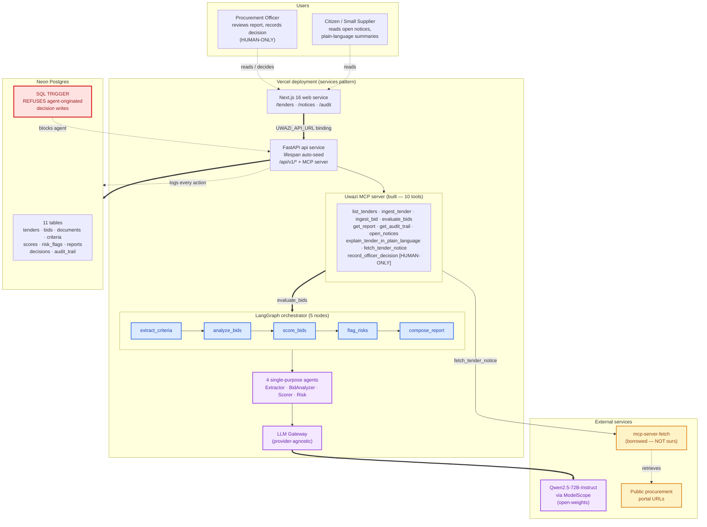

<div align="center">

# Uwazi

### Evidence-first tender review for African procurement teams.

**Uwazi turns tender and bid documents into a cited review pack designed for a roughly 20-minute committee review. It never awards the tender: the AI proposes and the procurement committee decides.**

Built for the [Agentic AI for Africa Innovation Challenge — Governance track](https://agentic-africa-challenge.lovable.app/tracks/governance), Bid Box Challenge, *Digital economy / Open contracting* theme.

[]()
[]()
[]()
[]()
[]()
[]()

</div>

---

## One command

```bash
git clone https://github.com/Roy-Wanyoike/uwazi.git
cd uwazi
./run-demo.sh
```

That's it. The script creates a venv, installs Uwazi, seeds a synthetic Makueni County water-procurement scenario with three bids, runs the LangGraph agent, demonstrates the human-in-the-loop boundary, and opens the review UI at http://localhost:8000.

## Architecture

The system in one diagram. (Full architectural contract in [ARCHITECTURE.md](./ARCHITECTURE.md).)



**The architectural rule (red trigger above):** the agent may propose scores, risk flags, and recommendations. The agent may **never** record a decision. Enforced at the SQL layer (`CHECK + BEFORE INSERT` trigger), the MCP tool layer (`record_officer_decision` refuses agent principals), and the test suite.

## The idea in 60 seconds

| | Uwazi |
|---|---|
| **Primary user** | A county tender evaluation committee preparing its review file. |
| **Job to be done** | Check mandatory documents, compare bids criterion by criterion, surface risks, and assemble a report that can answer “where did this finding come from?” |
| **Input** | A tender document and the bid documents supplied to the committee. |
| **Output** | A ranked **draft** review pack with paragraph-level citations, risk flags, cost metadata, and an audit trail. |
| **Hard boundary** | Uwazi cannot award, accept, or reject a tender. A named human records the decision. |
| **Open-contracting layer** | Citizens and small suppliers get plain-language notices, eligibility requirements, and mandatory-document checklists. |

This is not a chatbot and it is not an autonomous procurement officer. It is the evidence-preparation layer between a pile of tender documents and the committee's legal decision.

## What Uwazi does

A procurement office receives a tender and N bids. The challenge brief describes this as 26 days of committee work: sorting bids, ticking off documents, checking each bidder, comparing prices, and writing the report. Uwazi targets a roughly 20-minute first-pass review pack, with a hard rule: **the agent prepares the file; it never awards the tender.**

The workflow:

1. **`ingest_tender`** — the agent reads the tender (PDF or Markdown), extracts the evaluation criteria with citations to specific paragraphs.
2. **`ingest_bid`** — the agent ingests each bid document against the tender.
3. **`evaluate_bids`** — a five-node LangGraph workflow runs per bid:
   - **ExtractorAgent** → criteria with citations
   - **BidAnalyzerAgent** → responses per criterion with citations
   - **ScorerAgent** → 0–10 score per (bid, criterion) pair with citations
   - **RiskAgent** → compliance risks per bid with citations
   - **OrchestratorAgent** → ranked report with per-bid recommendation
4. **`get_report`** — the procurement officer opens the report. Every score is one click from the source paragraph it was derived from.
5. **`record_officer_decision`** — the officer records `accept` / `reject` / `needs_review` per bid. **HUMAN-ONLY.** The agent never writes the decision — there is a SQL `CHECK + trigger` that refuses any agent-originated insert.
6. **`get_audit_trail`** — full structured audit trail of AI proposals + human decisions, available through MCP, the API, and the review UI.

For the *Digital economy / Open contracting* theme, Uwazi also exposes:

- **`open_notices`** — a citizen-facing tool that returns every active tender in plain English: eligibility checklist, mandatory documents, deadlines. No legalese, no AI inferences — just structured facts.
- **`explain_tender_in_plain_language`** — an AI-generated plain-language summary for a small supplier, citizen, or journalist. Every claim cites a paragraph. Stamped `ai_generated=True`.
- **`fetch_tender_notice`** — pulls a tender notice from a public procurement portal URL via the **official `mcp-server-fetch` MCP server** (a server Uwazi did not write).

### Data boundary

Public contracting portals publish notices and awards, but generally not the confidential bid documents needed for bid evaluation. Uwazi therefore uses public-style notice fields plus synthetic tender and bid documents. The prototype demonstrates the evaluation workflow without claiming that its sample bids are real or that Makueni County has endorsed the project.

## The architectural rule (the most important sentence in this README)

> **The agent may propose scores, risk flags, and recommendations. The agent may NEVER record a decision.**

Enforced at three layers — see [ARCHITECTURE.md](./ARCHITECTURE.md):

1. **SQL** — `CHECK (decided_by <> 'agent')` + `BEFORE INSERT` trigger on `decisions`. A judge can verify this in 60 seconds:
   ```bash
   sqlite3 uwazi.db "INSERT INTO decisions (id, tender_id, bid_id, decision, rationale, decided_by, decided_at) VALUES ('hack', 't', 'b', 'accept', 'agent hack', 'agent', datetime('now'));"
   # → Parse error: agent may not record decisions — human-in-the-loop rule (ARCHITECTURE.md §5)
   ```
2. **MCP tool** — `record_officer_decision` refuses any request where `principal_kind='agent'`. Verified by `tests/test_human_in_the_loop.py`.
3. **Verification** — focused tests exercise both the tool-layer refusal and the database constraint.

## Tech stack

| Layer | Technology | Why |
|---|---|---|
| **MCP server** (built) | `mcp` Python SDK (FastMCP), 10 tools | The protocol surface for the entire workflow. |
| **MCP server** (borrowed) | Official `mcp-server-fetch` | Handles HTTP redirects, gzip, charset detection, HTML stripping, robots.txt, SSRF protection. ~500 LOC saved. |
| **Orchestration** | LangGraph (`StateGraph` + `MemorySaver`) | Open-source, Apache 2.0. The de-facto orchestrator for agent workflows with named-tool calls. |
| **LLM gateway** | `openai` SDK pointed at any OpenAI-compatible endpoint | Default: **Qwen2.5-72B-Instruct via ModelScope** (open-weights). Also supports OpenAI for side-by-side and local Llama via Ollama for fully on-prem. |
| **Document ingestion** | `pdfplumber` (PDF) + Markdown reader | Paragraph-level citation tracking — works for both PDFs (page-based) and Markdown (no pages). |
| **Storage** | SQLite (portable to Postgres) | Zero-config for the demo; portable for production. |
| **Review UI** | Next.js + FastAPI | Server-rendered procurement review UI backed by the Python API. |
| **Tests** | `pytest` + `pytest-asyncio` | 42 tests, ~5.5s on Windows. |

## Project structure

```
uwazi/
├── README.md                  ← you are here
├── ARCHITECTURE.md            ← one-page architectural contract (judge-required)
├── EVALS.md                   ← 42 tests + 1 known unfixed failure (judge-required)
├── INVESTORS.md               ← market, business model, traction, roadmap
├── JUDGE_GUIDE.md             ← walks through every judging criterion
├── SUBMISSION_TEXT.md         ← 300-word submission text (judge-required)
├── SUBMISSION.md              ← build-window scope + 5 files to read first
├── DEMO_SCRIPT.md             ← 20-minute live review walkthrough
├── run-demo.sh                ← one-command demo
├── pyproject.toml
├── .env.example
├── docs/
│   └── architecture-deep-dive.md  ← the full ADR + schema contract
├── src/uwazi/
│   ├── config.py              ← env-driven settings
│   ├── models.py              ← Pydantic domain models
│   ├── db.py                  ← SQLite schema + audit trail + decision CHECK + trigger
│   ├── pdf.py                 ← PDF + Markdown ingestion, paragraph-level citations
│   ├── citation.py            ← 5-check citation validator (fails closed)
│   ├── gateway.py             ← provider-agnostic LLM gateway (STUB mode + real)
│   ├── prompts.py             ← every system + user prompt in one module
│   ├── agents.py              ← ExtractorAgent, BidAnalyzerAgent, ScorerAgent, RiskAgent
│   ├── orchestrator.py        ← LangGraph StateGraph (5 nodes, 1 conditional edge)
│   ├── external_mcp.py        ← integration with official mcp-server-fetch
│   ├── mcp_server.py          ← FastMCP server: 10 tools
│   ├── api.py                 ← FastAPI review UI
│   └── cli.py                 ← CLI driver
├── web/index.html             ← procurement officer review screen
├── samples/
│   ├── tender-makueni-water.md      ← synthetic tender (real-shape)
│   ├── tender-makueni-water.ocds.json ← same tender in OCDS (Open Contracting Data Standard)
│   ├── bid-aquaforce.md             ← clean bid
│   ├── bid-hydrotech.md             ← missing mandatory ISO 9001 (RiskAgent flag)
│   └── bid-sahara.md                ← anomalous-low financial (RiskAgent flag)
├── scripts/
│   ├── seed.py                ← seeds the sample tender + 3 bids
│   └── demo-video-script.md   ← 3-minute unedited video script
└── tests/
    ├── test_citation.py
    ├── test_pdf.py
    ├── test_human_in_the_loop.py
    └── test_mcp_tools.py
```

## Quick start (the long version)

If `./run-demo.sh` is too magical, here are the steps it runs:

```bash
git clone https://github.com/Roy-Wanyoike/uwazi.git
cd uwazi
python -m venv .venv && source .venv/bin/activate
pip install -e ".[dev]"
cp .env.example .env   # set OPENAI_API_KEY for real Qwen scores; leave blank for STUB

# 1. Seed the sample tender + 3 bids
python scripts/seed.py

# 2. Run the agentic evaluation
python -m uwazi.cli evaluate --tender-id makueni-water-2026

# 3. Demonstrate the human-in-the-loop boundary
python -m uwazi.cli demonstrate-human-in-the-loop --tender-id makueni-water-2026

# 4. Open the procurement officer review UI
python -m uwazi.cli serve    # → http://localhost:8000

# 5. (Optional) Drive Uwazi from any MCP client
python -m uwazi.cli mcp      # stdio MCP server
```

## License

MIT. See [LICENSE](./LICENSE).

<div align="center">

**AI recommends. The procurement officer decides.**

</div>
