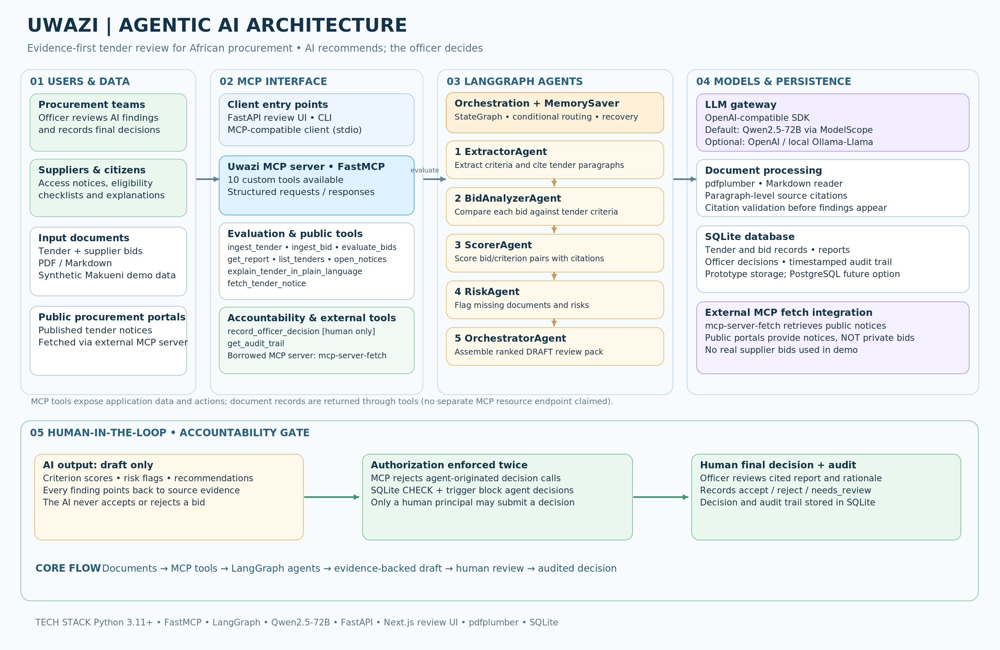

<div align="center">

# Uwazi

### Evidence-first tender review for African procurement teams.

**Uwazi turns tender and bid documents into a cited review pack designed for a roughly 20-minute committee review. It never awards the tender: the AI proposes and the procurement committee decides.**

Built for the [Agentic AI for Africa Innovation Challenge — Governance track](https://agentic-africa-challenge.lovable.app/tracks/governance), Bid Box Challenge, *Digital economy / Open contracting* theme.

[]()
[]()
[]()
[]()
[]()
[]()

</div>

---

## Problem statement

Public procurement in African institutions is slow, opaque, and expensive. The challenge brief itself states the number: a single tender evaluation takes **26 days of committee work today** — sorting bids, ticking off mandatory documents, checking each bidder, comparing prices, and writing the report. Across the continent, that is billions of USD in deferred decisions, locked-up supplier cash, and lost opportunities for small suppliers who cannot navigate the bureaucracy.

The status quo has three structural failures:

1. **Time.** 26 days of committee work per tender. Procurement offices are bottlenecked; small suppliers wait months to be paid; capital sits idle.
2. **Opacity.** A small supplier cannot easily find an active tender, understand the eligibility, or prepare the mandatory documents. The pipeline is legible only to insiders — exactly the constituency that doesn't need it.
3. **Auditability.** When a tender is contested — by a losing bidder, by an audit office, by a journalist — the procurement office's defence rests on a Word document edited by hand and signed by one person. There is no machine-readable audit trail.

## Solution overview

Uwazi is an agentic AI on the Model Context Protocol that turns the 26-day evaluation into a 30-minute officer-reviewed exercise. The agent ingests a tender document and N bid documents, extracts the evaluation criteria, scores every bid against every criterion with paragraph-level citations, flags compliance risks (missing mandatory documents, abnormally low financials), and produces a ranked report with a per-bid recommendation. A procurement officer then records `accept` / `reject` / `needs_review` decisions — the **only entity that can write the decision field**.

For the *Digital economy / Open contracting* theme, Uwazi also exposes a citizen-facing layer: an `open_notices` tool that returns every active tender in plain English (eligibility checklist, mandatory documents, deadlines) — making the procurement pipeline legible to citizens and small suppliers, not just to insiders.

The hard architectural rule, enforced at three layers (SQL `CHECK + trigger`, MCP tool, test suite):

> **The agent may propose scores, risk flags, and recommendations. The agent may NEVER record a decision.**

## Target users

| User | What they get from Uwazi |
|---|---|
| **Procurement committees / evaluation officers** | A cited draft review pack in ~20 minutes instead of 26 days. Every score, risk flag, and recommendation is one click from the source paragraph. They retain the legal decision — the agent never awards a tender. |
| **Citizens & small suppliers** | Plain-language tender notices, eligibility checklists, mandatory-document lists, and AI explanations with citations. Reduces the barrier to entry for first-time bidders. |
| **Audit offices & journalists** | A machine-readable audit trail of every AI proposal + human decision, timestamped and attributable. Exportable as a signed PDF for the procurement archive. |
| **Procurement regulators (PPRA, PPDA, RPPA)** | An open-source reference implementation of an MCP-native, human-in-the-loop tender evaluation workflow that they can self-host. Procurement data never leaves their jurisdiction. |

## One command

```bash
git clone https://github.com/Roy-Wanyoike/uwazi.git
cd uwazi
./run-demo.sh
```

That's it. The script creates a venv, installs Uwazi, seeds a synthetic Makueni County water-procurement scenario with three bids, runs the LangGraph agent, demonstrates the human-in-the-loop boundary, and opens the review UI at http://localhost:8000.

A live deployment is also running on Vercel (Next.js + FastAPI multi-service) backed by a Neon Postgres database: **https://uwazi-rose.vercel.app**

## Architecture



The diagram above shows the full system: users (procurement teams + suppliers/citizens) → MCP interface (FastMCP server, 10 tools, borrowed `mcp-server-fetch`) → LangGraph agents (5-node pipeline) → models & persistence (LLM gateway, document processing, SQLite/Postgres) → human-in-the-loop accountability gate at the bottom (AI output is draft-only → authorization enforced twice → human final decision + audit trail).

For the one-page architectural contract, see [ARCHITECTURE.md](./ARCHITECTURE.md). For the deep-dive (rules, ADRs, schema), see [docs/architecture-deep-dive.md](./docs/architecture-deep-dive.md).

## Setup & installation instructions

### Prerequisites

- **Python** 3.11+
- **Node.js** 22+ (for the Next.js frontend)
- **Internet access** for the initial `pip install` and `npm install`

### One-command setup (recommended)

```bash
git clone https://github.com/Roy-Wanyoike/uwazi.git
cd uwazi
./run-demo.sh
```

The script does everything: creates a Python virtualenv, installs Python + Node deps, seeds the sample Makueni tender + 3 bids, runs the LangGraph agent, demonstrates the human-in-the-loop boundary, and opens the review UI at http://localhost:8000.

### Manual setup (if you'd rather see what's happening)

```bash
git clone https://github.com/Roy-Wanyoike/uwazi.git
cd uwazi

# Python side
python -m venv .venv && source .venv/bin/activate
pip install -e ".[dev]"
cp .env.example .env   # set OPENAI_API_KEY for real Qwen scores; leave blank for STUB

# Frontend side (optional — the Python-only review UI at /web/index.html works too)
cd apps/web && npm install && cd ..

# Seed + run
python scripts/seed.py
python -m uwazi.cli evaluate --tender-id makueni-water-2026
python -m uwazi.cli serve    # → http://localhost:8000
```

### Configuration (`.env`)

Every setting has a sensible default — the demo runs without any configuration. For real LLM scores (instead of STUB mode), set:

```bash
OPENAI_API_KEY=<your-modelscope-inference-token>  # NOT the read-only Studio token — needs inference scope
OPENAI_BASE_URL=https://api-inference.modelscope.ai/v1
OPENAI_MODEL=Qwen-Ambassador/Qwen3.7-Max
```

## Usage instructions

### As a procurement officer (via the review UI)

1. Open http://localhost:8000 (or the Vercel deployment URL).
2. Click **Tenders** in the header → select the Makueni County Water Reticulation Project.
3. If no report is shown, click **Run agentic evaluation** — the LangGraph orchestrator runs the 5-node workflow (extract criteria → analyze bids → score → flag risks → compose report).
4. Review the ranked bids. Each card shows the AI recommendation (`award` / `shortlist` / `reject`), weighted score, risk flags with citations, and an expandable list of scores with paragraph-level citations back to the tender and bid documents.
5. Click **Accept** / **Needs review** / **Reject** on each bid, enter a rationale (≥10 chars), and submit. The decision is persisted with `decided_by='officer-web'` and added to the audit trail.
6. Click **View audit trail** to see every AI proposal and human decision, timestamped and attributable.

### As a citizen or small supplier (via the Open Notices page)

1. Open http://localhost:8000 (or the Vercel deployment URL).
2. Click **Open Notices** in the header.
3. Every active tender is shown in plain English: eligibility checklist, mandatory documents to prepare, and apply instructions. No legalese.

### As an MCP client (Claude Desktop, custom agent, etc.)

```bash
python -m uwazi.cli mcp      # starts the FastMCP server on stdio
```

Connect from any MCP-compatible client. All 10 tools are listed below in the [MCP tools / servers](#mcp-tools--servers) section.

### Via the CLI

```bash
python -m uwazi.cli evaluate --tender-id makueni-water-2026        # run the agent
python -m uwazi.cli report   --tender-id makueni-water-2026         # fetch the ranked report
python -m uwazi.cli audit    --tender-id makueni-water-2026         # fetch the audit trail
python -m uwazi.cli demonstrate-human-in-the-loop --tender-id ...  # show the SQL trigger refusing an agent principal
python -m uwazi.cli serve                                         # start the FastAPI review UI
python -m uwazi.cli mcp                                          # start the MCP server (stdio)
```

## Technology stack

| Layer | Technology | Why |
|---|---|---|
| **MCP server** (built) | `mcp` Python SDK (FastMCP), 10 tools | The protocol surface for the entire workflow. |
| **MCP server** (borrowed) | Official `mcp-server-fetch` | Handles HTTP redirects, gzip, charset detection, HTML stripping, robots.txt, SSRF protection. ~500 LOC saved. |
| **Orchestration** | LangGraph (`StateGraph` + `MemorySaver`) | Open-source, Apache 2.0. The de-facto orchestrator for agent workflows with named-tool calls. |
| **LLM gateway** | `openai` SDK pointed at any OpenAI-compatible endpoint | Default: **Qwen2.5-72B-Instruct via ModelScope** (open-weights). Also supports OpenAI for side-by-side and local Llama via Ollama for fully on-prem. |
| **Document ingestion** | `pdfplumber` (PDF) + Markdown reader | Paragraph-level citation tracking — works for both PDFs (page-based) and Markdown (no pages). |
| **Storage** | SQLite (local dev) / Postgres (production) | Dual-backend via `DATABASE_URL`. Production backs Vercel Postgres / Neon. |
| **Backend API** | FastAPI (Python 3.12) | Hosts the MCP server, the REST API used by the frontend, and the lifespan auto-seed handler. |
| **Frontend** | Next.js 16 + TypeScript + Tailwind CSS 4 | Server-rendered procurement review UI. Pages: `/`, `/tenders`, `/tenders/[id]`, `/notices`, `/audit/[id]`. |
| **Deployment** | Vercel (services pattern) | `api` service (FastAPI) + `web` service (Next.js), bound via `UWAZI_API_URL`. |
| **Tests** | `pytest` + `pytest-asyncio` | 42 tests, ~1.5s. 5 are negative-path tests that verify the architectural rule refuses agent-originated decisions. |

## Agent architecture

Uwazi is a LangGraph state machine with 5 nodes and 1 conditional edge. The agent plans, calls tools, recovers from failure, and stops at a hard human-in-the-loop gate.

```
                    ┌──────────────────────────────────────────┐
                    │           UWAZI LANGGRAPH GRAPH          │
                    └──────────────────────────────────────────┘

START → extract_criteria → analyze_bids → score_bids → flag_risks → compose_report → END
            │                  │              │             │              │
            └── (no criteria) ──────────────────────────────→ compose_report

Nodes (each is an async function of state):
  extract_criteria  ExtractorAgent     over tender paragraphs (LLM call)
  analyze_bids      BidAnalyzerAgent   per bid (LLM call)
  score_bids        ScorerAgent        per (bid, criterion) pair (LLM call)
  flag_risks        RiskAgent          per bid (LLM call)
  compose_report    OrchestratorAgent  pure Python (no LLM)
```

State is a single `TypedDict` (`UwaziState`) that flows through every node. Each node returns a partial dict that LangGraph merges. The graph is compiled with `MemorySaver` checkpointer — an interrupted evaluation can be resumed from the last checkpoint (not yet wired into the UI; see *Limitations* below).

**Recovery path:** if `extract_criteria` returns an empty list (the LLM found no criteria), the conditional edge skips `analyze_bids → score_bids → flag_risks` and jumps to `compose_report`, which produces a report with `errors=["extractor: no criteria"]` rather than crashing. Per-bid failures in `analyze_bids` / `score_bids` / `flag_risks` are caught, logged to `state["errors"]`, and the bid is short-circuited — the rest of the bids continue.

**Why LangGraph over a hand-rolled loop:** it is a state machine. Each node is a function. The edges are conditional. The graph can be visualised (`graph.get_graph().draw_*`). State persists to SQLite (`langgraph-checkpoint-sqlite`), so an interrupted evaluation can be resumed. It is the de-facto open-source orchestrator for agent workflows with named-tool calls — strangers reading the code recognise the shape immediately.

## MCP implementation

Uwazi is **MCP-native**. Every capability — ingesting documents, extracting criteria, scoring bids, recording decisions, fetching external tender notices — is exposed as an MCP tool. The orchestrator agent is an MCP client that calls the tools through the protocol.

This means:

- **Any MCP-compatible client** (Claude Desktop, the MCP CLI, a custom agent) can drive Uwazi.
- **The procurement office can swap the LLM** (Qwen, GPT, Claude, local Llama) without touching the agent code.
- **The human-in-the-loop boundary is enforced at the MCP tool layer**: `record_officer_decision` is the only tool that writes to the decision table, and it requires a human principal. The SQL `CHECK + trigger` is the second line of defense.

The MCP server is implemented in `src/uwazi/mcp_server.py` using the official `mcp` Python SDK's `FastMCP` class. The server runs on stdio transport by default (`python -m uwazi.cli mcp`), or as part of the FastAPI service on Vercel.

### MCP servers built vs borrowed

| MCP server | Source | Why |
|---|---|---|
| **Uwazi MCP server** (`src/uwazi/mcp_server.py`) | **Built.** FastMCP on stdio. 10 tools (see below). | The challenge requires our own server with ≥3 tools; this is the protocol surface for the entire workflow. |
| **Official MCP fetch server** (`mcp-server-fetch`) | **Borrowed.** Anthropic / MCP maintainers. | Handles HTTP redirects, gzip, charset detection, HTML stripping, robots.txt respect, and SSRF protection — features that would take ~500 LOC to reproduce. Used by `fetch_tender_notice` to pull tender notices from public procurement portals. Any upstream improvement lands in our agent without a single PR. |

## MCP tools / servers

Uwazi's FastMCP server exposes **10 tools**:

| Tool | What it does | Who can call |
|---|---|---|
| `list_tenders` | List all ingested tenders (most recent first). | Any MCP client. |
| `fetch_tender_notice` | Pull a tender notice from a public procurement portal URL via the **official `mcp-server-fetch`** (a server Uwazi did not write). Saves the content as a new tender document. | Any MCP client. |
| `ingest_tender` | Parse a tender PDF or Markdown into paragraphs, store it. | Any MCP client. |
| `ingest_bid` | Parse a bid PDF or Markdown, store it against a tender. | Any MCP client. |
| `evaluate_bids` | Run the LangGraph orchestrator workflow. Returns the ranked report. | Any MCP client. |
| `get_report` | Fetch the latest evaluation report (citations, scores, risk flags). | Any MCP client. |
| `open_notices` | Citizen-facing tool — every active tender in plain English with eligibility + mandatory documents. | Any MCP client. |
| `explain_tender_in_plain_language` | AI-generated plain-language summary for a small supplier, citizen, or journalist. Every claim cites a paragraph. Stamped `ai_generated=True`. | Any MCP client. |
| `record_officer_decision` | Officer records `accept` / `reject` / `needs_review`. **HUMAN-ONLY.** | Requires a human principal (`principal.kind='human'`). The tool refuses requests where `principal.kind='agent'`. |
| `get_audit_trail` | Full audit trail of AI proposals + human decisions, timestamped and attributable. | Any MCP client. |

## Human-in-the-loop workflow

The single most important architectural rule:

> **The agent may propose scores, risk flags, and recommendations. The agent may NEVER record a decision.**

Enforced at three layers:

1. **SQL** — `CHECK (decided_by <> 'agent')` + `BEFORE INSERT` trigger on `decisions`. A judge can verify this in 60 seconds:
   ```bash
   sqlite3 uwazi.db "INSERT INTO decisions (id, tender_id, bid_id, decision, rationale, decided_by, decided_at) VALUES ('hack', 't', 'b', 'accept', 'agent hack', 'agent', datetime('now'));"
   # → Parse error: agent may not record decisions — human-in-the-loop rule (ARCHITECTURE.md §5)
   ```
   On Postgres (Vercel/Neon), the trigger is split into a `CREATE OR REPLACE FUNCTION refuse_agent_decision_writer() RETURNS TRIGGER` + `CREATE TRIGGER` — the same rule, dialect-appropriate syntax.
2. **MCP tool** — `record_officer_decision` refuses any request where `principal_kind='agent'`. Verified by `tests/test_human_in_the_loop.py::test_tool_refuses_agent_principal`.
3. **Verification** — focused tests exercise both the tool-layer refusal and the database constraint. The suite runs on every commit.

### The workflow in practice

1. The agent runs the 5-node LangGraph workflow and produces a ranked report with scores, risk flags, and recommendations — all stamped `ai_generated=True`.
2. The procurement officer opens the report in the review UI. Every score is one click from the source paragraph it was derived from.
3. The officer records `accept` / `reject` / `needs_review` per bid, with a rationale (≥10 chars). The decision is persisted with `decided_by='officer-demo'` (or the OIDC principal in production).
4. The audit trail captures every AI proposal and every human decision, timestamped and attributable. Exportable as a signed PDF for the procurement archive.

## Limitations

Uwazi is honest about what's unfinished. The brief rewards honesty about this.

- **Run-to-run variance on the real open-weights model is not measured.** STUB mode is deterministic; the real Qwen endpoint should be near-deterministic at `temperature=0.0` but I have not measured σ per criterion. See [EVALS.md](./EVALS.md) — this is the one failure I did not fix, with a concrete next-step plan.
- **LangGraph checkpoint resume is not yet wired into the UI.** The graph is compiled with `MemorySaver`, so an interrupted evaluation can in principle be resumed, but the review UI does not yet expose the resume button.
- **PDF ingestion is tested only via the Markdown path.** `pdf.py` supports PDFs via `pdfplumber`, but the test suite covers Markdown only. Committing a binary PDF would bloat the repo. To verify manually: `python -c "from uwazi.pdf import ingest_pdf; print(len(ingest_pdf('/path/to/real.pdf')))"`.
- **The external `mcp-server-fetch` is only tested manually.** The test suite verifies the fallback path (server not available → graceful degradation). The happy path (real URL fetch) requires a running subprocess.
- **The `/api/debug` endpoint leaks env var names + safe values.** Disable in production by deleting `apps/web/app/api/debug/route.ts` or guarding behind `process.env.NODE_ENV !== 'production'`.
- **No real LLM API key set in the deployed demo.** The current Vercel deployment uses STUB mode (no `OPENAI_API_KEY`) so every bid scores 0.0 — the workflow runs end-to-end but scores aren't differentiated. Set a real ModelScope inference token to see non-zero scores.
- **No production auth.** The deployment uses `OFFICER_PRINCIPAL_ID=officer-demo`. In production, this should come from OIDC (Keycloak) — the code is structured to accept it, but not wired up.
- **No multi-tenant isolation.** Single-tenant per deployment. A procurement office runs their own instance.

## Future improvements

| Quarter | Milestone |
|---|---|
| **Q4 2026** | Uwazi v1.0 — this submission. MCP server + 10 tools + 4-agent LangGraph workflow + review UI + audit trail + Vercel deploy + Neon Postgres storage. |
| **Q1 2027** | Kenya pilot — one county procurement office (target: Makueni or Kirinyaga). Real tender data, real officer feedback. First audit-trail PDF exported to a real audit office. Wire LangGraph checkpoint resume into the UI. Add a per-criterion σ measurement harness (`--measure-variance` CLI command). |
| **Q2 2027** | Supplier SaaS launch — plain-language tender notices, deadline alerts, eligibility checker. Freemium, USD 19/mo. Add per-country adapters (Kenya PPIP, Tanzania PPRA, Uganda PPDA, Rwanda RPPA) mirroring the `civic-intelligence` adapter pattern. |
| **Q3 2027** | EAC expansion — Tanzania, Uganda, Rwanda. Per-country procurement-portal crawlers wired into `fetch_tender_notice`. |
| **Q4 2027** | Pan-African — 9 OCDS-publishing authorities. Series A. Replace the SQLite/Postgres storage layer with Vercel Postgres + Neon pooled connection for production scale. Add OIDC auth + per-tenant isolation. |

## Project structure

```
uwazi/
├── README.md                  ← you are here
├── ARCHITECTURE.md            ← one-page architectural contract (judge-required)
├── EVALS.md                   ← 42 tests + 1 known unfixed failure (judge-required)
├── INVESTORS.md               ← market, business model, traction, roadmap
├── JUDGE_GUIDE.md             ← walks through every judging criterion
├── DEMO_SCRIPT.md             ← 20-minute live review walkthrough
├── run-demo.sh                ← one-command demo
├── pyproject.toml
├── .env.example
├── docs/
│   ├── architecture.png       ← the architecture diagram shown above
│   └── architecture-deep-dive.md  ← the full ADR + schema contract
├── src/uwazi/
│   ├── config.py              ← env-driven settings
│   ├── models.py              ← Pydantic domain models
│   ├── db.py                  ← dual-backend (SQLite/Postgres) schema + trigger
│   ├── pdf.py                 ← PDF + Markdown ingestion, paragraph-level citations
│   ├── citation.py            ← 5-check citation validator (fails closed)
│   ├── gateway.py             ← provider-agnostic LLM gateway (STUB mode + real)
│   ├── prompts.py             ← every system + user prompt in one module
│   ├── agents.py              ← ExtractorAgent, BidAnalyzerAgent, ScorerAgent, RiskAgent
│   ├── orchestrator.py        ← LangGraph StateGraph (5 nodes, 1 conditional edge)
│   ├── external_mcp.py        ← integration with official mcp-server-fetch
│   ├── mcp_server.py          ← FastMCP server: 10 tools
│   ├── api.py                 ← FastAPI review UI + lifespan auto-seed
│   └── cli.py                 ← CLI driver
├── apps/web/                  ← Next.js 16 frontend (Vercel-deployed)
│   ├── app/                   ← App Router pages: /, /tenders, /notices, /audit
│   ├── lib/api.ts             ← typed API client (reads UWAZI_API_URL binding)
│   └── public/                ← logo, brand, favicon SVGs
├── samples/
│   ├── tender-makueni-water.md      ← synthetic tender (real-shape)
│   ├── tender-makueni-water.ocds.json ← same tender in OCDS (Open Contracting Data Standard)
│   ├── bid-aquaforce.md             ← clean bid
│   ├── bid-hydrotech.md             ← missing mandatory ISO 9001 (RiskAgent flag)
│   └── bid-sahara.md                ← anomalous-low financial (RiskAgent flag)
├── scripts/
│   ├── seed.py                ← seeds the sample tender + 3 bids
│   └── demo-video-script.md   ← 3-minute unedited video script
└── tests/
    ├── test_citation.py
    ├── test_pdf.py
    ├── test_human_in_the_loop.py
    └── test_mcp_tools.py
```

## License

MIT. See [LICENSE](./LICENSE).

<div align="center">

**AI recommends. The procurement officer decides.**

</div>
